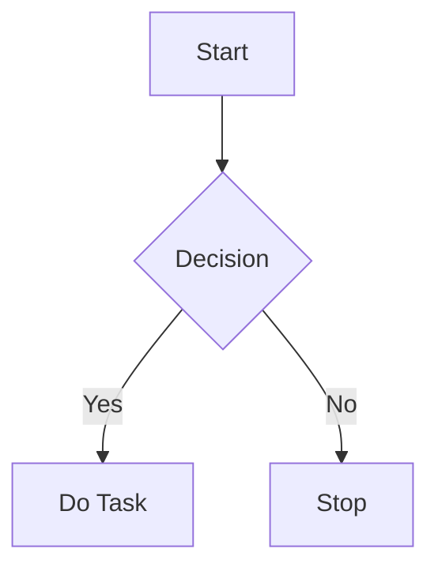
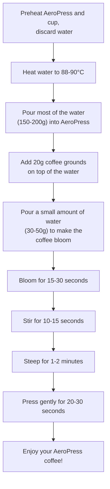

# VS Code: Showing Mermaid diagrams in Markdown documents

Install extension:
"Markdown Preview Mermaid Support"

CTRL+SHIFT+V : Toggle preview mode.

## EXAMPLE 1

## EXAMPLE 2

---

## TEST

hello
